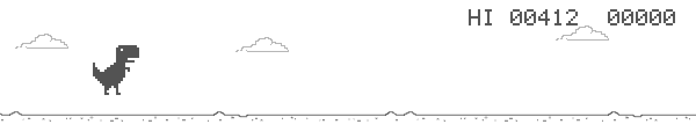
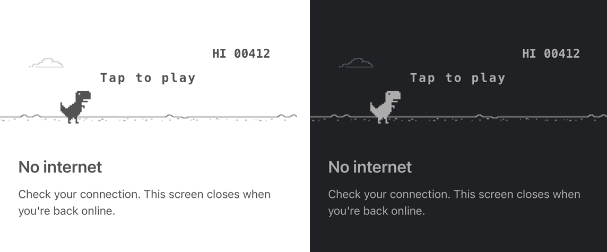

<p align="center">
  
</p>

<h1 align="center">🦖 react-native-offline-game</h1>

<p align="center">
  <b>Chrome's "No internet" dinosaur game, for your React Native app.</b><br />
  When the connection drops, your users get a game instead of a dead end.<br />
  When it comes back, the game gets out of the way. No code from you.
</p>

<p align="center">
  <a href="https://www.npmjs.com/package/react-native-offline-game"></a>
  
  
  
  
  
</p>

---

## ✨ Why you'll like it

- 🔌 **One line to add.** Drop `<OfflineGame />` into your app. It watches the connection for you.
- 🧘 **Never flickers.** It waits a moment and double-checks before it appears, and ignores quick blips while you're reconnecting.
- 🎮 **Plays like the real thing.** Tap to jump. The ground speeds up as you go, and the score blinks every 100 points.
- 🔊 **Retro beeps.** Optional jump, crash and milestone sounds, made in code. No audio files.
- 📴 **Works truly offline.** Everything it draws is built in. Nothing to download, even in a dev build in airplane mode.
- 🌗 **Light and dark.** Follows the phone's theme automatically.
- 🪶 **Tiny.** About **6 kB** gzipped in your app, artwork included.

<p align="center">
  
</p>

## 🚀 Quick start

**1. Install it**, together with NetInfo, which tells it when you're offline:

```sh
npx expo install react-native-offline-game @react-native-community/netinfo
```

<details>
<summary>Not using Expo?</summary>

```sh
npm install react-native-offline-game @react-native-community/netinfo
npx pod-install
```

</details>

**2. Add it once**, next to your app's root:

```tsx
import OfflineGame from 'react-native-offline-game';

export default function App() {
  return (
    <>
      <YourApp />
      <OfflineGame />
    </>
  );
}
```

**3. Turn on airplane mode.** 🛫 That's it.

> 💡 **Want to see it without losing Wi-Fi?** Add `isOffline` for a moment:
> `<OfflineGame isOffline />`, then take it out again.

## 🎬 What your users see

```text
Connection drops
  ├─ wait 1.5 s ─► double-check ─► the dino page fades in
  └─ back before that? nothing appears

Connection comes back
  ├─ wait 1 s ─► the page fades out
  └─ drops again before that? keep playing
```

- A full-screen **"No internet"** page fades in over your app with the game ready to play.
- **Tap anywhere** to start. Tap to jump over the hurdles.
- When the internet is back, the page **closes on its own**, even mid-game.

It counts as offline when there's no network at all, **or** when there's a network that can't reach the internet (like hotel Wi-Fi before you log in).

## 🧩 Recipes

### Remember the high score

The page remembers the best score while the app is open. To keep it forever, save it yourself, for example with AsyncStorage:

```tsx
const [best, setBest] = useState(0);

useEffect(() => {
  AsyncStorage.getItem('dinoBest').then((v) => setBest(Number(v) || 0));
}, []);

<OfflineGame
  highScore={best}
  onHighScoreChange={(score) => AsyncStorage.setItem('dinoBest', String(score))}
/>;
```

### Turn on the sounds 🔊

Install [`react-native-audio-api`](https://github.com/software-mansion/react-native-audio-api) and the game starts beeping. There's nothing else to change:

```sh
npx expo install react-native-audio-api react-native-worklets
```

- It's a native library, so it needs a [development build](https://docs.expo.dev/develop/development-builds/introduction/). In Expo Go the game simply stays silent.
- The beeps respect the iPhone's silent switch and play over the user's music instead of stopping it.

Prefer your own sounds or a little vibration? Turn the beeps off and react to each moment:

```tsx
<OfflineGame
  sounds={false}
  onSound={(sound) => {
    // sound is 'jump', 'hit' or 'score'
    if (sound === 'hit') Haptics.notificationAsync();
  }}
/>
```

### Say it your way

```tsx
<OfflineGame
  title="You're offline"
  message="Your changes are saved. Have a quick game while we reconnect."
  colorScheme="dark" // or 'light', or 'auto' (the default)
/>
```

### Use your own offline check

Already know when your server is unreachable? Pass it in. NetInfo is then ignored, but the smooth timing still applies:

```tsx
<OfflineGame isOffline={!serverReachable} />
```

### Just the game

Want the game somewhere else, such as an empty state or a loading screen? Use `DinoGame`:

```tsx
import { DinoGame } from 'react-native-offline-game';

<DinoGame style={{ marginVertical: 24 }} />;
```

### Check the internet with your own server

NetInfo checks for internet access by loading a small Google URL. If your users are somewhere Google is blocked, point it at your own server **before** `OfflineGame` first appears, for example in your entry file:

```ts
import NetInfo from '@react-native-community/netinfo';

NetInfo.configure({ reachabilityUrl: 'https://your-api.example.com/health' });
```

> ⚠️ Calling `NetInfo.configure()` later, after things are already listening, quietly disconnects them from NetInfo. Do it once at startup.

## 📖 API

### `<OfflineGame />`

The full-screen page. Render it once, and it shows up by itself when needed.

| Prop | Type | Default | What it does |
| --- | --- | --- | --- |
| `isOffline` | `boolean` | *uses NetInfo* | Decide yourself when the page shows. |
| `showDelay` | `number` | `1500` | Milliseconds the connection must stay down before the page opens. |
| `hideDelay` | `number` | `1000` | Milliseconds the connection must stay back before the page closes. |
| `title` | `string` | `"No internet"` | The heading under the game. |
| `message` | `string` | `"Check your connection…"` | The text under the heading. |
| `dismissible` | `boolean` | `false` | Let Android's back button close the page until the next drop. |
| `onShow` | `() => void` | | The page opened. |
| `onReconnect` | `() => void` | | The page closed because the internet is back. |

It also takes all the `<DinoGame />` props below.

### `<DinoGame />`

The game on its own: 120 points tall, as wide as its container. Tap it to start, jump and restart. It pauses when the app goes to the background.

| Prop | Type | Default | What it does |
| --- | --- | --- | --- |
| `highScore` | `number` | `0` | Best score to show at the start. |
| `onHighScoreChange` | `(score) => void` | | A run beat the best score. |
| `onGameOver` | `(score) => void` | | The dinosaur hit a hurdle. |
| `sounds` | `boolean` | `true` | Beep on jumps, crashes and every 100 points (needs `react-native-audio-api`). |
| `onSound` | `('jump' \| 'hit' \| 'score') => void` | | Each of those moments, for your own sounds or haptics. |
| `colorScheme` | `'auto' \| 'light' \| 'dark'` | `'auto'` | `'auto'` follows the phone's theme. |
| `options` | `{ fps?, skySpeed?, groundSpeed? }` | `{ fps: 60, skySpeed: 40, groundSpeed: 360 }` | Frame rate cap, cloud speed and starting ground speed (points per second). |
| `style` | `ViewStyle` | | Style for the game's box. |

Give it a `ref` to control it from code: `ref.current.tap()` and `ref.current.pause()`.

### `useIsOffline()`

The same check `OfflineGame` uses, without the waiting. It returns `true` when the device is offline.

```tsx
const offline = useIsOffline();
```

## ❓ FAQ

<details>
<summary><b>The page never appears in the iOS Simulator</b></summary>

The iOS Simulator uses your Mac's internet and has no airplane mode. Turn off your Mac's Wi-Fi, or add `isOffline` while you test. On the Android emulator, turning on airplane mode (or off Wi-Fi and mobile data) works.

</details>

<details>
<summary><b>Does it work in Expo Go?</b></summary>

Yes, everything except the sounds, which need a development build. See [Turn on the sounds](#turn-on-the-sounds-).

</details>

<details>
<summary><b>Dark mode isn't kicking in (Expo)</b></summary>

New Expo apps lock themselves to light mode. Set `"userInterfaceStyle": "automatic"` in `app.json`, or pass `colorScheme="dark"`.

</details>

<details>
<summary><b>Can users close the page and keep using my app offline?</b></summary>

On Android, set `dismissible` and the back button closes it until the next time the connection drops. For anything else, control it yourself with `isOffline`.

</details>

<details>
<summary><b>How big is it, really?</b></summary>

About 6 kB gzipped (13 kB minified) in your app's JavaScript, including all the artwork, which is one built-in image under 1 kB. The npm download is 19 kB. Sounds add nothing; they're generated in code.

</details>

## 🙏 Credits

The game is based on [react-dinosaur-game](https://github.com/LzxHahaha/react-dinosaur-game) by LzxHahaha, and on the T-Rex game from the Chromium project. See [LICENSE](LICENSE) for their notices.

## 📄 License

MIT © Sagar Khengat
