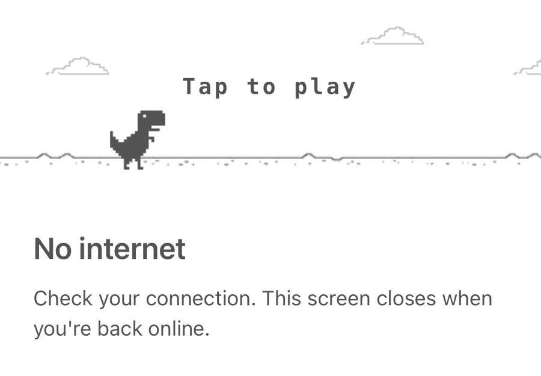

# react-native-offline-game

Chrome's "No internet" dinosaur page for React Native apps. When the device
loses its connection, a full-screen page with the T-Rex runner game appears on
top of your app. When the connection comes back, it closes by itself.

<p align="center">
  
</p>

- Appears and closes on its own, using
  [`@react-native-community/netinfo`](https://github.com/react-native-netinfo/react-native-netinfo).
- Buffered detection: brief drops, network switches and flaky reconnects
  don't make the screen flash open and closed.
- Plain React Native views and images, no canvas or WebView. Works in Expo Go
  and bare apps on iOS and Android.
- Light and dark themes, follows the device setting. (In Expo, set
  `"userInterfaceStyle": "automatic"` in `app.json`, or the app always
  reports light mode.)
- The game is also exported on its own if you want to build your own screen.

## Install

```sh
npm install react-native-offline-game @react-native-community/netinfo
```

Expo:

```sh
npx expo install react-native-offline-game @react-native-community/netinfo
```

For a bare React Native app, run `npx pod-install` afterwards so iOS links
NetInfo.

## Usage

Render `OfflineGame` once, near the root of your app. It renders nothing while
the device is online.

```tsx
import OfflineGame from 'react-native-offline-game';

export default function App() {
  return (
    <>
      <RootNavigator />
      <OfflineGame />
    </>
  );
}
```

### Keeping the high score

The page remembers the best score while the app is running. To keep it between
launches, save it yourself, for example with AsyncStorage:

```tsx
const [best, setBest] = useState(0);

useEffect(() => {
  AsyncStorage.getItem('dinoHighScore').then((v) => setBest(Number(v) || 0));
}, []);

<OfflineGame
  highScore={best}
  onHighScoreChange={(score) =>
    AsyncStorage.setItem('dinoHighScore', String(score))
  }
/>;
```

### How offline is detected

The device counts as offline when NetInfo reports no connection
(`isConnected === false`) or a connection without internet access
(`isInternetReachable === false`, for example Wi-Fi with no internet behind it).

Detection is buffered so the page doesn't flicker:

1. The connection has to stay down for `showDelay` (1.5 s by default).
2. Before the page opens, NetInfo runs a fresh internet check. The page only
   opens if that check also says offline, or doesn't answer within 3 seconds.
   If it says online, it waits another `showDelay` and checks again.
3. Once the page is open, the connection has to stay back for `hideDelay`
   (1 s by default) before the page closes. If it drops again within that
   time, the page stays open and the game keeps going.

NetInfo checks internet access by requesting a small URL. If your users are on
networks where Google is blocked, point it at your own server once at startup:

```ts
import NetInfo from '@react-native-community/netinfo';

NetInfo.configure({ reachabilityUrl: 'https://example.com/health' });
```

To use your own logic instead, pass `isOffline`. NetInfo is then ignored and
only the two delays apply:

```tsx
<OfflineGame isOffline={!apiReachable} />
```

## Props

### `OfflineGame`

| Prop | Type | Default | Description |
| --- | --- | --- | --- |
| `isOffline` | `boolean` | NetInfo | Overrides the built-in connection check. |
| `showDelay` | `number` | `1500` | Ms the connection must stay down before the page opens. |
| `hideDelay` | `number` | `1000` | Ms the connection must stay back before the page closes. |
| `dismissible` | `boolean` | `false` | Lets the Android back button close the page until the next drop. |
| `title` | `string` | `'No internet'` | Heading under the game. |
| `message` | `string` | `"Check your connection. This screen closes when you're back online."` | Text under the heading. |
| `onShow` | `() => void` | | Called when the page opens. |
| `onReconnect` | `() => void` | | Called when the page closes because the connection is back. |
| `highScore` | `number` | `0` | High score to show at the start. |
| `onHighScoreChange` | `(highScore: number) => void` | | Called when a run beats the high score. |
| `onGameOver` | `(score: number) => void` | | Called when the dinosaur hits a hurdle. |
| `colorScheme` | `'auto' \| 'light' \| 'dark'` | `'auto'` | Theme. `'auto'` follows the device. |
| `options` | `{ fps?, skySpeed?, groundSpeed? }` | `{ fps: 60, skySpeed: 40, groundSpeed: 100 }` | Frame rate cap and speeds in points per second. |

### `DinoGame`

The game strip on its own, 120 points tall and as wide as its container. It
takes `options`, `highScore`, `onHighScoreChange`, `onGameOver`, `colorScheme`
and `style`. Tap it to start, jump and restart. A ref gives you `tap()` and
`pause()`. The game pauses by itself when the app goes to the background.

```tsx
import { DinoGame } from 'react-native-offline-game';

<DinoGame style={{ marginTop: 40 }} />;
```

### `useIsOffline()`

The NetInfo check used by `OfflineGame`, without the delays. Returns `true`
when the device is offline.

## Credits

Based on [react-dinosaur-game](https://github.com/LzxHahaha/react-dinosaur-game)
by LzxHahaha, and on the T-Rex game from the Chromium project. See
[LICENSE](LICENSE) for their notices.

## License

MIT
